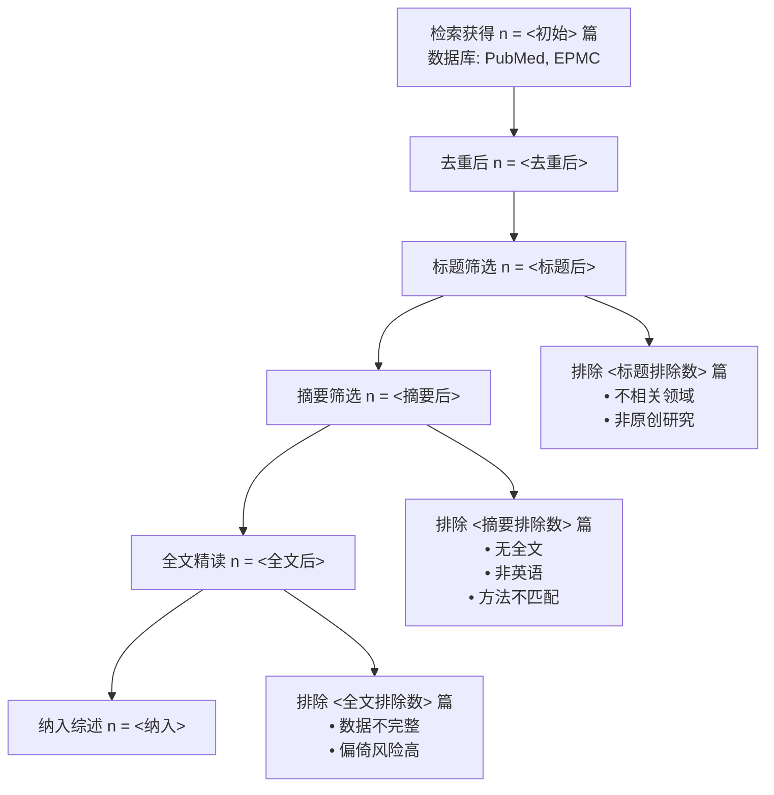
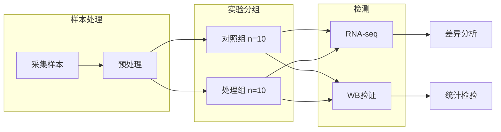

# Mermaid Diagrams - 科学图表生成

## 何时触发

- 需要画实验流程图
- 需要画 PRISMA 文献筛选流程图（配合 lit-agent review 的输出）
- 需要画路径/信号通路示意图
- 需要画时间线/甘特图
- 论文 Methods 里需要可视化实验流程

## 图表类型与对应的科研场景

| 图表类型 | mermaid 类型 | 科研场景 |
|----------|-------------|----------|
| 流程图 | `flowchart TD/LR` | 实验步骤、算法流程、样本处理 |
| PRISMA 图 | `flowchart TD` | 文献筛选流程（检索→去重→筛选→纳入） |
| 时间线 | `gantt` | 实验计划、研究时间安排、动物实验日程 |
| 分类/关系 | `graph TD` | 信号通路简化版、基因调控关系 |
| 状态图 | `stateDiagram-v2` | 细胞状态转换、疾病进展模型 |
| 时序图 | `sequenceDiagram` | 多步骤实验操作、API 调用链 |
| 类图 | `classDiagram` | 数据模型、数据库 schema |
| 饼图 | `pie` | 样本组成、预算分配 |

## PRISMA 流程图模板

lit-agent 的 review 命令输出里已有 PRISMA 数据，把数字填进这个模板即可：



## 实验流程图模板



## Mermaid 语法速查

### 节点形状
```
A[矩形]  B(圆角)  C([椭圆])  D[[子程序]]  E[(数据库)]  
F((圆))  G>菱形]  H{判断}  I{{六边形}}
```

### 连线
```
A --> B        实线箭头
A --- B        实线无箭头
A -.-> B       虚线箭头
A ==> B        加粗箭头
A --文字--> B  带标签连线
```

### 样式
```
style A fill:#4C72B0,stroke:#333,color:#fff
classDef highlight fill:#E69F00,stroke:#333
class B,C highlight
```

### 子图
```
subgraph 标题
  A --> B
end
```

## 颜色规范

优先用 Okabe-Ito 配色（色盲友好）：
```
#E69F00 (橙)  #56B4E9 (天蓝)  #009E73 (绿)
#F0E442 (黄)  #0072B2 (蓝)    #D55E00 (朱红)
#CC79A7 (紫)  #000000 (黑)
```

## 工作流程

1. **确认图类型**：用户想表达什么关系（步骤顺序/层级/时间/交互）？
2. **提取关键节点**：不超过 10 个主节点，否则拆分子图
3. **画骨架**：先写连线关系，再加样式
4. **添加文字标签**：连线上的条件/数值
5. **生成**：输出 mermaid 代码块，用户直接贴到支持 mermaid 的 markdown 编辑器中渲染

## 输出格式

```markdown
以下是 [图表类型] 的 Mermaid 代码：

` ` `mermaid
flowchart TD
    ...
` ` `

渲染效果: [用文字简单描述图看起来应该是什么样]
```

## 注意事项

- 一个图不超过 15 个节点，多了拆成两张图
- 节点文字尽量短（中文 ≤ 8 字，英文 ≤ 20 字符/词）
- PRISMA 图外框数字必须和 lit-agent review 输出的实际数据对应
- 流程图方向：TD（上到下）适合筛选流程，LR（左到右）适合实验步骤
